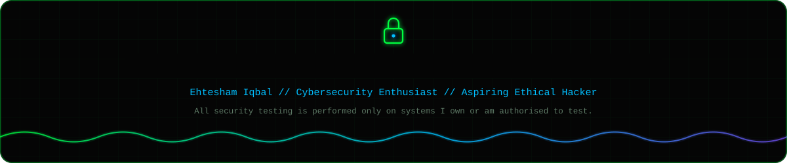

Hi I'm Ahtesham Iqbal
Computer science
 student
[README.md](https://github.com/user-attachments/files/35295162/README.md)

## `01` About Me

I'm **Ehtesham Iqbal**, a Computer Science student building a solid foundation in **cybersecurity and ethical hacking**.

I want to understand how systems are attacked so that I can help defend them better. I spend my time learning networking, Linux and web application security, and practising with tools such as **Nmap, Wireshark and Burp Suite** in my own lab. I also document what I learn along the way.

My goal is to grow into a skilled, ethical **penetration tester** who helps organisations find and fix weaknesses before attackers do.

> **Ethics first:** every scan, test and exploit I practise is run only in my own lab or on platforms and systems where I have explicit permission.

## `02` Current Focus

- **Networking:** strengthening TCP/IP, DNS and HTTP/HTTPS fundamentals.
- **Reconnaissance:** practising network scanning and traffic analysis with Nmap and Wireshark in a home lab.
- **Web application security:** working through the OWASP Top 10 with Burp Suite and OWASP ZAP.
- **Linux:** improving command-line and Bash skills on Kali Linux.
- **Documenting:** writing up what I learn, step by step.

## `03` Cybersecurity Skills & Technologies

🟢 Familiar with (hands-on in labs and coursework) &nbsp;·&nbsp; 🔵 Currently learning &nbsp;·&nbsp; 🟣 Future learning goal

| Domain | Skills |
| :-- | :-- |
| **Cybersecurity Fundamentals** | 🔵 Information Security · 🔵 CIA Triad · 🔵 Cybersecurity Fundamentals · 🔵 Network Security · 🔵 Operating System Security · 🔵 Risk Assessment |
| **Ethical Hacking & Penetration Testing** | 🔵 Ethical Hacking Fundamentals · 🔵 Penetration Testing Fundamentals · 🔵 Reconnaissance · 🔵 Vulnerability Assessment · 🔵 Web Application Security · 🔵 OWASP Top 10 |
| **Networking** | 🔵 TCP/IP · 🔵 DNS · 🔵 HTTP/HTTPS · 🔵 Firewalls · 🔵 VPN · 🟢 Network Scanning · 🟢 Wireshark |
| **Operating Systems** | 🔵 Linux · 🟢 Kali Linux · 🔵 Ubuntu · 🟢 Windows · 🟢 Command Line · 🟢 Bash Fundamentals |
| **Cybersecurity Tools** | 🟢 Nmap · 🟢 Wireshark · 🟢 Burp Suite · 🟢 Metasploit · 🟢 OWASP ZAP · 🟢 Gobuster · 🟢 Nessus |
| **Programming & Scripting** | 🟢 Python · 🟢 Bash · 🟢 Java · 🟢 SQL · 🟢 HTML · 🟢 CSS |
| **Additional Security Domains** | 🟣 Digital Forensics · 🟣 Incident Response · 🟣 Threat Intelligence · 🟣 Security Monitoring · 🟣 Cryptography · 🟣 SOC · 🟣 SIEM |

## `04` Tools & Technologies

 

## `05` Programming Languages

## `06` Currently Learning

| 🟢 Familiar With | 🔵 Currently Learning | 🟣 Future Learning Goals |
| :-- | :-- | :-- |
| Nmap · Wireshark Burp Suite · OWASP ZAP Metasploit · Gobuster · Nessus Kali Linux · Windows Command Line · Bash Python · Java · SQL HTML · CSS | Network Security TCP/IP · DNS · HTTP/HTTPS Firewalls · VPN Linux · Ubuntu Reconnaissance Vulnerability Assessment Web Application Security · OWASP Top 10 Penetration Testing Fundamentals | Digital Forensics Incident Response Threat Intelligence Security Monitoring Cryptography SOC & SIEM Fundamentals |

“Familiar with” means I have used it hands-on in labs and coursework, not that I have mastered it. I keep these lists honest and update them as I grow.

## `07` GitHub Statistics

## `08` Contribution Streak

## `09` Contribution Activity Graph

Stats are generated from public GitHub data by this repository's own GitHub Action and refresh daily.

## `10` Connect With Me

 

Add cybersecurity profile
